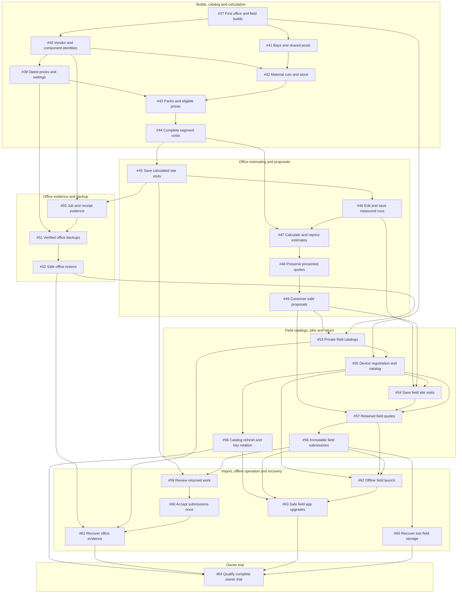

# Project Estimator: cross-epic dependencies

Snapshot checked November 02, 2026 at 07:14 AM CST.

28 open epic stories; 48 direct cross-epic dependency links. Each current epic story was read, and its **Prerequisite sibling keys** were resolved using its **Implementation-plan** filename and checked against both directions of GitHub’s native issue dependencies. All 28 prerequisite lists agree with the native links.

Only epic stories are included. Child-story dependencies, administrative index #36, and non-issue setup/owner-data checkpoints are outside this graph. The local startup handoff predates the sibling backlog; this report uses the live GitHub epic stories and dependency links.

## Dependency table

**Blocked by** lists direct prerequisites. **Blocking** lists direct dependents. These are recorded links, including links that also have an indirect path; they are not the transitive closure. All epics below were open at inspection, so all listed prerequisites remain open.

| Epic story | Blocked by | Blocking |
| --- | --- | --- |
| [#37](https://github.com/kburson/Project-Estimator/issues/37) — Deliver the first office and field builds | None | [#40](https://github.com/kburson/Project-Estimator/issues/40), [#41](https://github.com/kburson/Project-Estimator/issues/41), [#55](https://github.com/kburson/Project-Estimator/issues/55) |
| [#39](https://github.com/kburson/Project-Estimator/issues/39) — Keep dated prices and deliberate business settings | [#40](https://github.com/kburson/Project-Estimator/issues/40) | [#43](https://github.com/kburson/Project-Estimator/issues/43), [#51](https://github.com/kburson/Project-Estimator/issues/51) |
| [#40](https://github.com/kburson/Project-Estimator/issues/40) — Maintain vendor and component identities | [#37](https://github.com/kburson/Project-Estimator/issues/37) | [#39](https://github.com/kburson/Project-Estimator/issues/39), [#42](https://github.com/kburson/Project-Estimator/issues/42), [#50](https://github.com/kburson/Project-Estimator/issues/50) |
| [#41](https://github.com/kburson/Project-Estimator/issues/41) — Explain bays and shared posts | [#37](https://github.com/kburson/Project-Estimator/issues/37) | [#42](https://github.com/kburson/Project-Estimator/issues/42) |
| [#42](https://github.com/kburson/Project-Estimator/issues/42) — Explain material cuts and stock requirements | [#40](https://github.com/kburson/Project-Estimator/issues/40), [#41](https://github.com/kburson/Project-Estimator/issues/41) | [#43](https://github.com/kburson/Project-Estimator/issues/43) |
| [#43](https://github.com/kburson/Project-Estimator/issues/43) — Explain purchased packs and eligible prices | [#39](https://github.com/kburson/Project-Estimator/issues/39), [#42](https://github.com/kburson/Project-Estimator/issues/42) | [#44](https://github.com/kburson/Project-Estimator/issues/44) |
| [#44](https://github.com/kburson/Project-Estimator/issues/44) — Calculate complete segment costs | [#43](https://github.com/kburson/Project-Estimator/issues/43) | [#45](https://github.com/kburson/Project-Estimator/issues/45), [#47](https://github.com/kburson/Project-Estimator/issues/47) |
| [#45](https://github.com/kburson/Project-Estimator/issues/45) — Save and reopen calculated site visits | [#44](https://github.com/kburson/Project-Estimator/issues/44) | [#46](https://github.com/kburson/Project-Estimator/issues/46), [#50](https://github.com/kburson/Project-Estimator/issues/50), [#59](https://github.com/kburson/Project-Estimator/issues/59) |
| [#46](https://github.com/kburson/Project-Estimator/issues/46) — Edit and durably save measured runs | [#45](https://github.com/kburson/Project-Estimator/issues/45) | [#47](https://github.com/kburson/Project-Estimator/issues/47), [#54](https://github.com/kburson/Project-Estimator/issues/54) |
| [#47](https://github.com/kburson/Project-Estimator/issues/47) — Calculate and explicitly reprice saved estimates | [#44](https://github.com/kburson/Project-Estimator/issues/44), [#46](https://github.com/kburson/Project-Estimator/issues/46) | [#48](https://github.com/kburson/Project-Estimator/issues/48) |
| [#48](https://github.com/kburson/Project-Estimator/issues/48) — Preserve presented quotes | [#47](https://github.com/kburson/Project-Estimator/issues/47) | [#49](https://github.com/kburson/Project-Estimator/issues/49) |
| [#49](https://github.com/kburson/Project-Estimator/issues/49) — Export customer-safe proposals | [#48](https://github.com/kburson/Project-Estimator/issues/48) | [#53](https://github.com/kburson/Project-Estimator/issues/53), [#54](https://github.com/kburson/Project-Estimator/issues/54), [#57](https://github.com/kburson/Project-Estimator/issues/57) |
| [#50](https://github.com/kburson/Project-Estimator/issues/50) — Retain job and receipt evidence | [#40](https://github.com/kburson/Project-Estimator/issues/40), [#45](https://github.com/kburson/Project-Estimator/issues/45) | [#51](https://github.com/kburson/Project-Estimator/issues/51) |
| [#51](https://github.com/kburson/Project-Estimator/issues/51) — Create verified office backups | [#39](https://github.com/kburson/Project-Estimator/issues/39), [#50](https://github.com/kburson/Project-Estimator/issues/50) | [#52](https://github.com/kburson/Project-Estimator/issues/52) |
| [#52](https://github.com/kburson/Project-Estimator/issues/52) — Restore office work safely | [#51](https://github.com/kburson/Project-Estimator/issues/51) | [#53](https://github.com/kburson/Project-Estimator/issues/53), [#61](https://github.com/kburson/Project-Estimator/issues/61) |
| [#53](https://github.com/kburson/Project-Estimator/issues/53) — Prepare private field catalogs | [#49](https://github.com/kburson/Project-Estimator/issues/49), [#52](https://github.com/kburson/Project-Estimator/issues/52) | [#55](https://github.com/kburson/Project-Estimator/issues/55), [#61](https://github.com/kburson/Project-Estimator/issues/61) |
| [#54](https://github.com/kburson/Project-Estimator/issues/54) — Save field site visits | [#46](https://github.com/kburson/Project-Estimator/issues/46), [#49](https://github.com/kburson/Project-Estimator/issues/49), [#55](https://github.com/kburson/Project-Estimator/issues/55) | [#57](https://github.com/kburson/Project-Estimator/issues/57) |
| [#55](https://github.com/kburson/Project-Estimator/issues/55) — Register a device and install its first catalog | [#37](https://github.com/kburson/Project-Estimator/issues/37), [#53](https://github.com/kburson/Project-Estimator/issues/53) | [#54](https://github.com/kburson/Project-Estimator/issues/54), [#56](https://github.com/kburson/Project-Estimator/issues/56), [#57](https://github.com/kburson/Project-Estimator/issues/57), [#62](https://github.com/kburson/Project-Estimator/issues/62) |
| [#56](https://github.com/kburson/Project-Estimator/issues/56) — Refresh catalogs and rotate keys safely | [#55](https://github.com/kburson/Project-Estimator/issues/55) | [#63](https://github.com/kburson/Project-Estimator/issues/63), [#64](https://github.com/kburson/Project-Estimator/issues/64) |
| [#57](https://github.com/kburson/Project-Estimator/issues/57) — Present retained field quotes | [#49](https://github.com/kburson/Project-Estimator/issues/49), [#54](https://github.com/kburson/Project-Estimator/issues/54), [#55](https://github.com/kburson/Project-Estimator/issues/55) | [#58](https://github.com/kburson/Project-Estimator/issues/58), [#62](https://github.com/kburson/Project-Estimator/issues/62) |
| [#58](https://github.com/kburson/Project-Estimator/issues/58) — Return immutable field submissions | [#57](https://github.com/kburson/Project-Estimator/issues/57) | [#59](https://github.com/kburson/Project-Estimator/issues/59), [#62](https://github.com/kburson/Project-Estimator/issues/62), [#63](https://github.com/kburson/Project-Estimator/issues/63), [#65](https://github.com/kburson/Project-Estimator/issues/65) |
| [#59](https://github.com/kburson/Project-Estimator/issues/59) — Review returned field work in the office | [#45](https://github.com/kburson/Project-Estimator/issues/45), [#58](https://github.com/kburson/Project-Estimator/issues/58) | [#60](https://github.com/kburson/Project-Estimator/issues/60) |
| [#60](https://github.com/kburson/Project-Estimator/issues/60) — Accept reviewed field submissions exactly once | [#59](https://github.com/kburson/Project-Estimator/issues/59) | [#61](https://github.com/kburson/Project-Estimator/issues/61) |
| [#61](https://github.com/kburson/Project-Estimator/issues/61) — Recover catalog and imported office evidence | [#52](https://github.com/kburson/Project-Estimator/issues/52), [#53](https://github.com/kburson/Project-Estimator/issues/53), [#60](https://github.com/kburson/Project-Estimator/issues/60) | [#64](https://github.com/kburson/Project-Estimator/issues/64) |
| [#62](https://github.com/kburson/Project-Estimator/issues/62) — Launch the field application without network | [#55](https://github.com/kburson/Project-Estimator/issues/55), [#57](https://github.com/kburson/Project-Estimator/issues/57), [#58](https://github.com/kburson/Project-Estimator/issues/58) | [#63](https://github.com/kburson/Project-Estimator/issues/63) |
| [#63](https://github.com/kburson/Project-Estimator/issues/63) — Upgrade the field app without losing work | [#56](https://github.com/kburson/Project-Estimator/issues/56), [#58](https://github.com/kburson/Project-Estimator/issues/58), [#62](https://github.com/kburson/Project-Estimator/issues/62) | [#64](https://github.com/kburson/Project-Estimator/issues/64) |
| [#64](https://github.com/kburson/Project-Estimator/issues/64) — Qualify the complete owner trial | [#56](https://github.com/kburson/Project-Estimator/issues/56), [#61](https://github.com/kburson/Project-Estimator/issues/61), [#63](https://github.com/kburson/Project-Estimator/issues/63), [#65](https://github.com/kburson/Project-Estimator/issues/65) | None |
| [#65](https://github.com/kburson/Project-Estimator/issues/65) — Recover field work after storage loss | [#58](https://github.com/kburson/Project-Estimator/issues/58) | [#64](https://github.com/kburson/Project-Estimator/issues/64) |

## Cross-epic diagram

An arrow **A → B** means **A blocks B** (B is blocked by A). All 28 current epics and all 48 direct links are shown. Groups organize the drawing by subject; they do not represent parent epics or add dependencies. Labels are shortened; the table retains full epic titles.

## Reading the graph

- **Entry point:** #37 is the only current epic with no epic prerequisites. That does not establish implementation approval or satisfaction of owner/setup checkpoints.
- **First split:** after #37, #40 (catalog identities) and #41 (bays/posts) have their epic prerequisite satisfied. #42 reunites those branches; #43 also requires dated pricing from #39.
- **Office split:** after #45, the run/estimate/quote/proposal branch (#46 → #47 → #48 → #49) and the evidence/backup/restore branch (#50 → #51 → #52) feed #53. These are graph relationships, not worker-dispatch authorization.
- **Field convergence:** #55 enables field registration and catalog refresh. #54 also requires #46 and #49; #57 joins field visits, registration and proposals. #58 then feeds imports, offline operation and field recovery.
- **Final gate:** #64 is the only epic with no outgoing dependency links. It is directly blocked by #56, #61, #63 and #65. Every other current epic has a dependency path to #64.
- **Consistency:** no cycles were found; both API directions describe the same 48 edges. Epic numbering is not execution order: #40 precedes #39, #55 precedes #54, and #65 precedes #64.

## Superseded epic

| Epic story | State | Blocked by | Blocking | Treatment |
| --- | --- | --- | --- | --- |
| [#1](https://github.com/kburson/Project-Estimator/issues/1) — First usable construction estimator — Mac office and offline PWA | Closed (`not_planned`) | None | None | Its supersession marker points to #36. Retained here for completeness; excluded from the current dependency graph. |

## Source and verification

- Repository: [kburson/Project-Estimator](https://github.com/kburson/Project-Estimator). Each table row links to its source epic story.
- Epic inventory: all pages of `GET /repos/kburson/Project-Estimator/issues?labels=epic&state=all&per_page=100`, excluding pull requests. The label inventory agreed with the epic-title search: 29 epics total, including the one superseded epic.
- Native links: all pages of `GET /repos/kburson/Project-Estimator/issues/{number}/dependencies/blocked_by` and `/dependencies/blocking` for each epic.
- The table and diagram use the same native edge set. Dependency keys in the epic stories were independently compared with that set. No issue states or dependency links were changed.
- This is an epic-level snapshot, not a child-story audit, delivery forecast, or implementation-readiness assessment.
